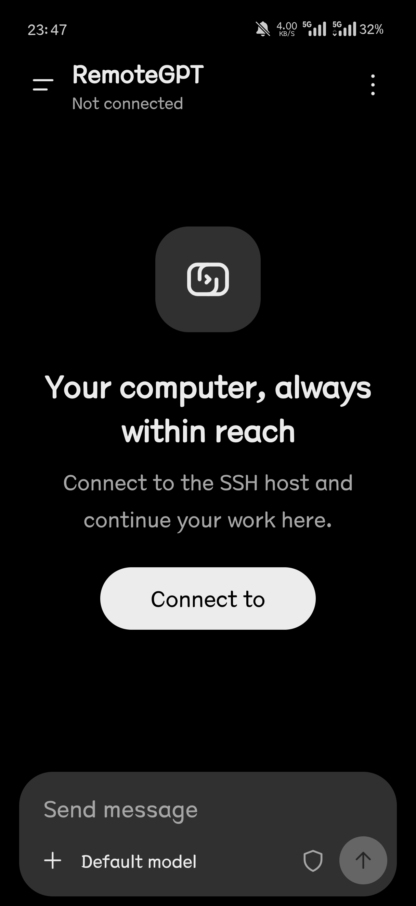
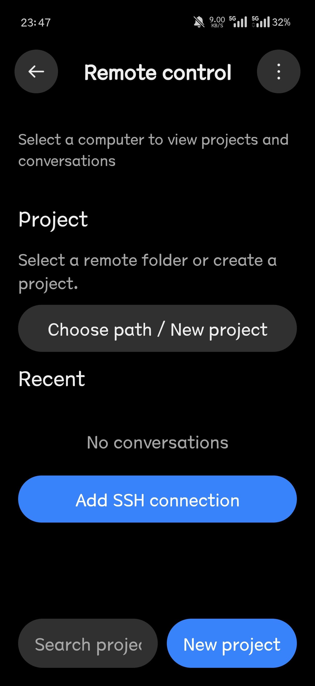
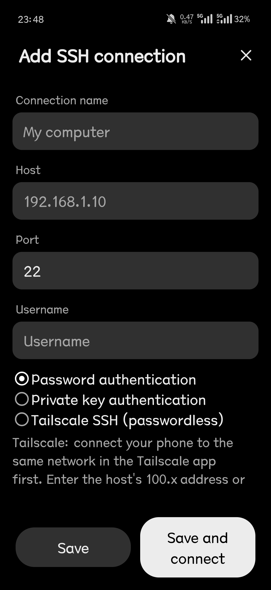
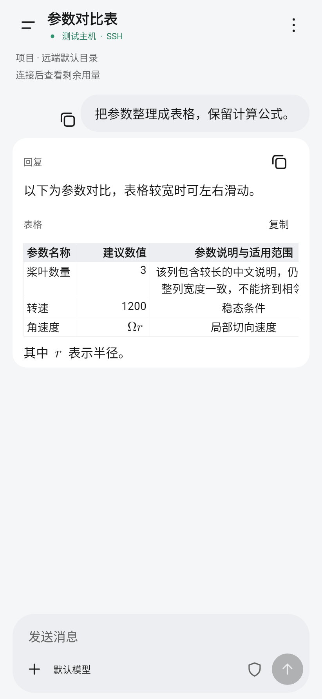

# RemoteGPT — Android Codex GUI Client over SSH

English · [简体中文](README.zh-CN.md)

A native Android app to remotely control OpenAI Codex over SSH. Manage coding sessions, approve commands, browse projects, and transfer files directly from your phone.

**[Download APK · 1.0.66](https://github.com/qzh775226913-ai/RemoteGPT/releases/download/v1.0.66/RemoteGPT-1.0.66-Android-universal-debug.apk)** · [Changelog](CHANGELOG.md) · [Issues](https://github.com/qzh775226913-ai/RemoteGPT/issues)

Current version: **1.0.66 / versionCode 68**. Android 8+.

## Screens

  

User-provided device screenshots: English home, remote control and SSH connection setup.

 

Left: synthetic formula and table example. Right: device notification example; appearance varies by device.

## Features

- Browse projects and history; keep drafts, attachments and status per conversation.
- Add input or queue a message during execution; respond to approvals and question forms.
- Select remote models, reasoning effort, speed and permissions.
- Transfer files; zoom and browse images with adjacent-image preloading.
- Read formulas and Markdown tables; copying preserves source text.
- Persistent mode retains remote tasks across SSH disconnections and restores them on reconnect.

## Interface languages

English · 简体中文 · 繁體中文 · 日本語 · 한국어 · Español · Português (Brasil) · Deutsch · Français · Русский

The interface follows your phone’s system language by default. Choose another language in Settings → Language; unsupported system languages fall back to English. Reasoning effort names stay in English, and server messages and errors keep their original text.

## Get started

1. Prepare SSH/SFTP and working Codex CLI access on the host. Persistent mode requires Python 3.8+.
2. Install the APK and add an SSH connection.
3. Choose a project, then create or resume a conversation.

## License

[Source-available license](LICENSE): use, modification and public collaboration are permitted. Non-commercial redistribution must retain attribution and license notices. Commercial reuse requires written permission. Independent client, unaffiliated with OpenAI.

[Contributing](CONTRIBUTING.md) · [Third-party licenses](docs/THIRD_PARTY.md)
