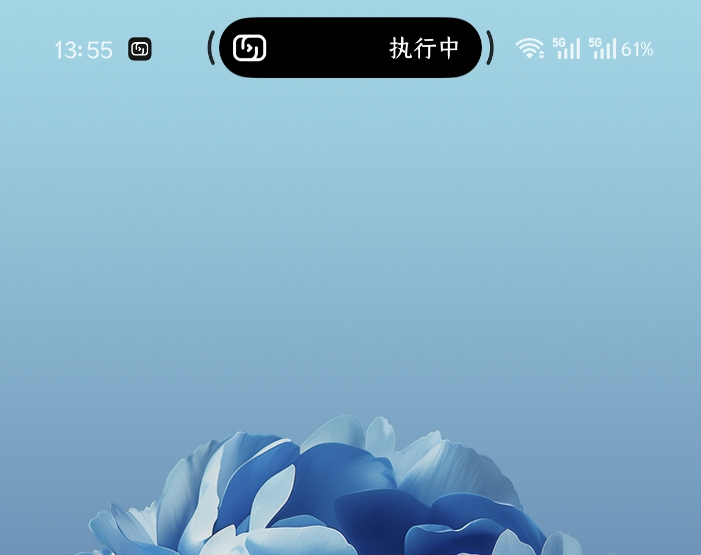

# RemoteGPT — Android GUI for Codex over SSH

[English](README.en.md) · 简体中文

在 Android 手机上通过 **图形化界面**操作远端 Codex：点选项目与历史会话、阅读对话、处理权限审批、回答结构化问题，以及上传和预览附件。适合已经使用 Codex CLI、希望离开电脑后继续查看和操作远端任务的用户。

服务器继续负责 Codex 运行与账户登录；手机负责触摸交互、状态展示和文件传输。项目为独立客户端，与 OpenAI 无隶属关系。

**[下载稳定版 APK（1.0.57）](https://github.com/qzh775226913-ai/RemoteGPT/releases/download/v1.0.57/RemoteGPT-1.0.57-Android-universal-debug.apk)** · [首次连接指南](docs/USAGE.md) · [发布说明与校验文件](https://github.com/qzh775226913-ai/RemoteGPT/releases/latest) · [问题反馈](https://github.com/qzh775226913-ai/RemoteGPT/issues)

当前源码版本：**1.0.58 / versionCode 60**（Tailscale 安装包交付）；GitHub 稳定版仍为 1.0.57。Android 8+，包名 `app.remotessh`，APK 约 4.4 MB。

## 图形化界面能做什么

| 操作 | 手机界面 |
| --- | --- |
| 打开项目与会话 | 浏览远端目录、点选历史会话，为不同会话保留独立草稿和附件 |
| 查看任务与回复 | 在对话中阅读输出、查看运行状态，执行中可补充输入或排队下一条消息 |
| 处理审批与提问 | 通过审批按钮和问题表单回复远端请求 |
| 调整模型与权限 | 使用选择面板设置模型、推理强度、运行速度和权限；模型信息连接期间每 30 秒从远端同步 |
| 传输图片与文件 | 使用系统选择器上传附件，直接预览与保存图片、下载普通文件 |

这些常用操作可以通过列表、按钮和表单完成，减少在手机小屏幕中输入命令、滚动终端和切换上下文的步骤。首次配置仍需具备 SSH 和远端 Codex 环境。

## 第一次使用

1. **确认远端可用**：连接用户已配置可用的 Codex CLI，服务器提供 SSH/SFTP；默认持久模式还需要 Python 3.8+。
2. **安装 APK 并添加连接**：填写手机可达的 SSH 主机、端口、用户名和认证信息，核对主机指纹。
3. **点选项目与会话**：浏览项目目录，新建对话或接续历史，手动发送第一条消息。

具体字段、环境检查和常见错误见 [首次连接指南](docs/USAGE.md)。远端无需为本应用额外开放模型服务 HTTP 端口；通信走 SSH。

## 任务通知示例



此图展示特定设备的状态区域。通知、气泡和后台表现取决于 Android 版本、权限与厂商系统；其他设备可能采用不同展示形式。

## 环境与支持范围

| 位置 | 要求 |
| --- | --- |
| 手机 | Android 8 或以上，可访问服务器的 SSH 地址 |
| 服务器 | Unix 环境、SSH/SFTP；连接用户已安装并配置支持 `app-server` 的 Codex CLI |
| 持久模式 | Python 3.8+，标准库包含 sqlite3、fcntl、Unix socket 支持，家目录可写 |

默认持久模式在 SSH 断开后保留远端任务，并支持重连后的输出和待审批恢复；主机或托管进程退出会影响恢复。模型、账户权限和服务费用由远端配置决定。设备及真实服务测试边界见 [验收标准](docs/ACCEPTANCE.md)。

## 构建与验证

技术栈：Java 17、Android 原生 View、JSch SSH/SFTP、stdio JSON-RPC；远端托管使用 Python 标准库。

开发环境：JDK 17、Android SDK 36、Build Tools 35.0.0、Python 3.12。配置 `JAVA_HOME` 和 `ANDROID_HOME` 后执行：

```sh
python3 -m venv .venv
.venv/bin/python -m pip install -r tools/requirements-dev.txt
.venv/bin/python tools/verify.py
```

完整入口运行 Python 与 Android 测试、结构和图标检查、APK 构建及 Lint。SSH 测试使用独立回环夹具。详细配置见 [开发手册](docs/DEVELOPMENT.md)，版本结果见 [1.0.54 验证](docs/verification/2026-10-16-1.0.54.md)。

## 文档与许可

[使用说明](docs/USAGE.md) · [需求](docs/REQUIREMENTS.md) · [架构](docs/ARCHITECTURE.md) · [维护规则](docs/MAINTENANCE.md) · [回退说明](docs/ROLLBACK.md) · [问题反馈](https://github.com/qzh775226913-ai/RemoteGPT/issues)

采用 [项目自定义许可](LICENSE)。正常使用免费；商业再利用及修改版发布的授权条件以 LICENSE 为准。Codex 服务费用另计。

## 公式与表格显示

新增本地原生公式排版：支持显式标记的行内／独立 TeX、分式、上下标、希腊字母和矩阵，长公式可横向滚动。复制保留原文；不完整或不支持的公式显示原始文本。当前 GitHub 稳定版 APK 为 1.0.57。[第三方组件说明](docs/THIRD_PARTY.md)。

1.0.57 增加可横向滚动的原生表格，并调整浅色区域层次。
